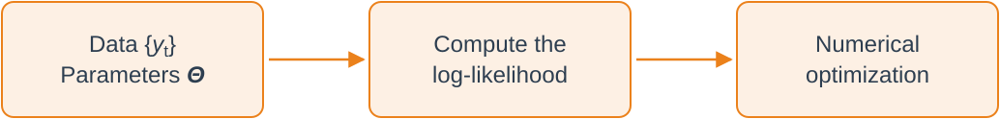
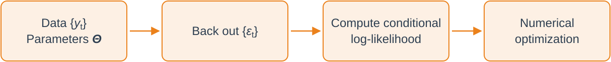

# Introduction {visibility="uncounted"}

## Where We Are

- So far, we took the parameters of ARMA models as given
- In practice, we need to _estimate_ them from data
- Many ways to do it: maximum likelihood, method of moments, Kalman filter, etc.
- We will focus on MLE
- Good software for ARMA estimation usually gives you several options
- More than mastering math tricks and details, understand the _big picture_

## A Preview

- It is always the MA part that complicates things
- A natural estimator for an AR($p$): OLS of $y_t$ on $y_{t-1}, \ldots, y_{t-p}$
- Mild conditions guarantee consistency, asymptotic normality, blah, blah, blah...
- But for ARMA($p,q$) models, we cannot do that! We do not observe $\varepsilon_t$!!!

. . .

- MLE requires a _distributional assumption_ for $\varepsilon_t$
- We will relax that later, when we touch on "_quasi-MLE_"
- We start with _given_ values of $p$ and $q$ and discuss model choice later

## Preliminaries

- Assume that $\varepsilon_t \iid N(0,\sigma^2)$
- This implies that $y_t$ is a Gaussian random variable. Why?

. . .

- Denote by $\symbf{\Theta}$ the vector of parameters to be estimated
- First step: characterize the joint distribution of the sample $\symbf{y} = (y_1, \ldots, y_T)'$
- Denote this distribution by $f_{y_T, y_{T-1}, \ldots, y_1}(\symbf{y}; \symbf{\Theta})$

. . .

- Recall: $f_{Y|X}(y \mid x) = f_{Y,X}(y, x) / f_X(x) \implies f_{Y,X}(y,x) = f_{Y|X}(y \mid x) f_X(x)$

. . .

- For any integer $k \geq 1$:

$$
\boxed{
f_{y_T, \ldots, y_1}(\symbf{y}; \symbf{\Theta})
= f_{y_k, \ldots, y_1}(y_k, \ldots, y_1; \symbf{\Theta})
\cdot \prod_{t=k+1}^T f_{y_t \mid y_{t-1}, \ldots, y_1}\bigl(y_t \mid y_{t-1}, \ldots, y_1; \symbf{\Theta}\bigr)
}
$$

## &nbsp; {.standout background-color="var(--slate)" visibility="uncounted"}

::: {.standout-body}
Questions?
:::

# The AR(p) Case {visibility="uncounted"}

## The AR($p$) Likelihood

- Consider the AR($p$) model below and let $\symbf{\Theta} = (c, \phi_1, \ldots, \phi_p, \sigma^2)$:

$$
y_t = c + \phi_1 y_{t-1} + \ldots + \phi_p y_{t-p} + \varepsilon_t, \qquad \varepsilon_t \iid N(0,\sigma^2)
$$

- Notice that $y_t \mid y_{t-1}, \ldots, y_{t-p} \sim N(c + \phi_1 y_{t-1} + \ldots + \phi_p y_{t-p}, \sigma^2)$. Therefore:

$$
f_{y_t | y_{t-1}, \ldots, y_1}(y_t \mid y_{t-1}, \ldots, y_1; \symbf{\Theta}) = \frac{1}{\sqrt{2\pi \sigma^2}} e^{-\frac{(y_t - c - \phi_1 y_{t-1} - \ldots - \phi_p y_{t-p})^2}{2\sigma^2}}
$$

. . .

- The likelihood of the first $p$ observations, $f_{y_p, \ldots, y_1}(y_p, \ldots, y_1; \symbf{\Theta})$, is more involved
- The $p \times 1$ vector $\symbf{y}_{1:p} = (y_1, \ldots, y_p)'$ is multivariate normal:

$$
\symbf{y}_{1:p} \sim N(\symbf{\mu}, \symbf{\Omega}), \qquad \symbf{\mu} = \frac{c}{1 - \sum_{i=1}^p \phi_i} \symbf{1}, \qquad \symbf{\Omega}_{ij} = \gamma(|i-j|) \quad \forall i,j \in \{1,\ldots,p\}
$$

## The Full Likelihood {.tightmath}

- The likelihood of the first $p$ observations is given by:

$$
f_{y_p, \ldots, y_1}(y_p, \ldots, y_1; \symbf{\Theta}) = (2\pi)^{-p/2}|\symbf{\Omega}^{-1}|^{1/2} e^{-\frac{1}{2} (\symbf{y}_{1:p} - \symbf{\mu})' \symbf{\Omega}^{-1} (\symbf{y}_{1:p} - \symbf{\mu})}
$$

. . .

- From here, we can write the full likelihood function:

::: {.eqfit}
$$
\begin{aligned}
f_{y_T, \ldots, y_1}(\symbf{y}; \symbf{\Theta}) &= f_{y_p, \ldots, y_1}(y_p, \ldots, y_1; \symbf{\Theta}) \cdot \prod_{t=p+1}^T f_{y_t \mid y_{t-1}, \ldots, y_1}\bigl(y_t \mid y_{t-1}, \ldots, y_1; \symbf{\Theta}\bigr)\\
&= (2\pi)^{-p/2}|\symbf{\Omega}^{-1}|^{1/2} e^{-\frac{1}{2} (\symbf{y}_{1:p} - \symbf{\mu})' \symbf{\Omega}^{-1} (\symbf{y}_{1:p} - \symbf{\mu})} \cdot \prod_{t=p+1}^T \frac{1}{\sqrt{2\pi \sigma^2}} e^{-\frac{(y_t - c - \sum_{i=1}^p \phi_i y_{t-i})^2}{2\sigma^2}}\\
&= (2\pi)^{-T/2} \sigma^{-(T-p)} |\symbf{\Omega}^{-1}|^{1/2} e^{-\frac{1}{2} (\symbf{y}_{1:p} - \symbf{\mu})' \symbf{\Omega}^{-1} (\symbf{y}_{1:p} - \symbf{\mu})} \cdot e^{-\frac{1}{2\sigma^2} \sum_{t=p+1}^T (y_t - c - \sum_{i=1}^p \phi_i y_{t-i})^2}
\end{aligned}
$$
:::

## The Log-Likelihood Function

- We always optimize the log-likelihood function $\mathcal{L}(\symbf{\Theta} \mid \symbf{y}) = \log f_{y_T, \ldots, y_1}(\symbf{y}; \symbf{\Theta})$:

$$
\begin{aligned}
\mathcal{L}(\symbf{\Theta} \mid \symbf{y}) &= -\frac{T}{2} \log(2\pi) - (T-p) \log(\sigma) + \frac{1}{2} \log|\symbf{\Omega}^{-1}| \\[0.3em]
&\qquad {\color[RGB]{198,40,40}{- \frac{1}{2} (\symbf{y}_{1:p} - \symbf{\mu})' \symbf{\Omega}^{-1} (\symbf{y}_{1:p} - \symbf{\mu})}} \; {\color[RGB]{0,114,188}{- \frac{1}{2\sigma^2} \sum_{t=p+1}^T \Bigl(y_t - c - \sum_{i=1}^p \phi_i y_{t-i}\Bigr)^2}}
\end{aligned}
$$

- The [blue]{.fgv} part looks like the OLS objective function
- The [red]{.bad} part "distorts" this objective function

## Full MLE Is Costly

- Full ML estimation requires optimizing this function w.r.t. $\symbf{\Theta}$
- This requires inverting a $p \times p$ matrix every time we evaluate the function

{width="72%" fig-alt="Flow diagram: data and parameters feed the log-likelihood computation, which feeds a numerical optimizer"}

. . .

- Wait a minute... what if $T \gg p$?
- Then the main contribution to the log-likelihood comes from the [blue]{.fgv} part

. . .

- This suggests a simpler approach: _conditional_ MLE
- Treat the first $p$ observations as fixed (non-random)
- Approximate $\mathcal{L}(\symbf{\Theta} \mid \symbf{y})$ by $\log f_{y_T, \ldots, y_{p+1} \mid \symbf{y}_{1:p}}(\symbf{y}; \symbf{\Theta})$

## The Numerical Shortcut for the AR($p$) Case

- Up to a constant, we have:

$$
\log f_{y_T, \ldots, y_{p+1} \mid \symbf{y}_{1:p}}(\symbf{y}; \symbf{\Theta}) = - \sum_{t=p+1}^T \frac{(y_t - c - \sum_{i=1}^p \phi_i y_{t-i})^2}{2\sigma^2} - (T-p) \log(\sigma)
$$

. . .

- The estimators for $c$ and the $\phi_i$'s are the OLS estimators from regressing $y_t$ on $y_{t-1}, \ldots, y_{t-p}$
- Super simple closed-form solutions! 😎
- The estimator for $\sigma^2$ is just the (biased) sample variance of the OLS residuals

. . .

- If $T$ is large, this is a very good approximation to the full MLE
- $\mathcal{L}(\symbf{\Theta} \mid \symbf{y})$ is efficiently computed using the Kalman filter: darker magic for next year!

## &nbsp; {.standout background-color="var(--slate)" visibility="uncounted"}

::: {.standout-body}
Questions?
:::

# The MA(q) Case {visibility="uncounted"}

## The MA($q$) Model

- Consider the MA($q$) model below and let $\symbf{\Theta} = (\mu, \theta_1, \ldots, \theta_q, \sigma^2)$:

$$
y_t = \mu + \varepsilon_t + \theta_1 \varepsilon_{t-1} + \ldots + \theta_q \varepsilon_{t-q}, \qquad \varepsilon_t \iid N(0,\sigma^2)
$$

- No hope for an "OLS"-type trick... we do not see the shocks...
- Again two main approaches: full MLE and conditional MLE
- We focus on conditional MLE; full MLE is in [Hamilton (1994)]{.fgv}, Chapter 5
- If $T$ is large, the two approaches give very similar results
- Similar to forecasting with finite data in the last lecture!

## Backing Out the Shocks

- Key observation: $y_t \mid \varepsilon_{t-1}, \ldots, \varepsilon_{t-q} \sim N(\mu + \theta_1 \varepsilon_{t-1} + \ldots + \theta_q \varepsilon_{t-q}, \sigma^2)$
- But how is that useful if we do not observe $\varepsilon_t$?

. . .

:::: {.columns}
::: {.column width="50%"}
- Assume $\varepsilon_{-q+1} = \ldots = \varepsilon_{0} = \E[\varepsilon_t] = 0$
- Then start a recursion, as in the forecasting case
- Given $\symbf{\Theta}$, every $\varepsilon_t$ is a function of the data
:::

::: {.column width="50%"}
$$
\begin{aligned}
\varepsilon_{1} &= y_{1} - \mu\\
\varepsilon_{2} &= y_{2} - \mu - \theta_1 \varepsilon_{1}\\
\varepsilon_{3} &= y_{3} - \mu - \theta_1 \varepsilon_{2} - \theta_2 \varepsilon_{1}\\
&\;\;\vdots\\
\varepsilon_{t} &= y_{t} - \mu - \theta_1 \varepsilon_{t-1} - \ldots - \theta_q \varepsilon_{t-q} \\
&\;\;\vdots\\
\varepsilon_{T} &= y_{T} - \mu - \theta_1 \varepsilon_{T-1} - \ldots - \theta_q \varepsilon_{T-q}
\end{aligned}
$$
:::
::::

## The Conditional Log-Likelihood Function

- From here, the conditional log-likelihood function is (up to a constant):

::: {.eqfit}
$$
\begin{aligned}
\log f_{y_T, \ldots, y_1 \mid \varepsilon_{-q+1} = \ldots = \varepsilon_{0} = 0}(\symbf{y}; \symbf{\Theta}) &= \sum_{t=1}^T \log f_{y_t \mid \varepsilon_{t-1}, \ldots, \varepsilon_{t-q}}(y_t \mid \varepsilon_{t-1}, \ldots, \varepsilon_{t-q}; \symbf{\Theta})\\
&= - \sum_{t=1}^T \frac{\varepsilon_t^2}{2\sigma^2} - T \log(\sigma)
\end{aligned}
$$
:::

- When there is an MA component, the logical flow is:

{width="86%" fig-alt="Flow diagram: data and parameters feed a step that backs out the shocks, then the conditional log-likelihood, then a numerical optimizer"}

## &nbsp; {.standout background-color="var(--slate)" visibility="uncounted"}

::: {.standout-body}
Questions?
:::

# The ARMA(p,q) Case {visibility="uncounted"}

## The ARMA($p,q$) Model

- Consider a Gaussian ARMA($p,q$) model and let $\symbf{\Theta} = (c, \phi_1, \ldots, \phi_p, \theta_1, \ldots, \theta_q, \sigma^2)$:

$$
y_t = c + \phi_1 y_{t-1} + \ldots + \phi_p y_{t-p} + \varepsilon_t + \theta_1 \varepsilon_{t-1} + \ldots + \theta_q \varepsilon_{t-q}, \qquad \varepsilon_t \iid N(0,\sigma^2)
$$

- We can combine the two previous approaches
- Given $\symbf{\Theta}$, we back out $\varepsilon_t$ recursively
- Notice that

$$
y_t \mid y_{t-1}, \ldots, y_1, \varepsilon_{t-1}, \ldots, \varepsilon_{t-q} \sim N\Bigl(c + \sum_{i=1}^p \phi_i y_{t-i} + \sum_{j=1}^q \theta_j \varepsilon_{t-j}, \; \sigma^2\Bigr)
$$

- Then we are ready to use the conditioning trick once again!

## The Recursion

- As with the AR($p$), treat $y_1, \ldots, y_p$ as fixed
- Assume that $\varepsilon_p = \varepsilon_{p-1} = \ldots = \varepsilon_{p-q+1} = 0$
- The first shock to be backed out is $\varepsilon_{p+1} = y_{p+1} - c - \sum_{i=1}^p \phi_i y_{p+1-i}$
- Then we get $\varepsilon_{p+2} = y_{p+2} - c - \sum_{i=1}^p \phi_i y_{p+2-i} - \theta_1 \varepsilon_{p+1}$
- And so on...

. . .

- Skeptical of "assuming values" for the shocks? Usually $p$ and $q$ are small compared to $T$!
- You will almost never see $q > 10$ or $p > 20$ in practice!

## The Conditional Log-Likelihood Function

- The conditional log-likelihood function, up to a constant, is:

::: {.eqfit}
$$
\mathcal{L}(\symbf{\Theta} \mid \symbf{y}) = \log f_{y_T, \ldots, y_{p+1} \mid \symbf{y}_{1:p},\, \varepsilon_p = \ldots = \varepsilon_{p-q+1} = 0}(\symbf{y}; \symbf{\Theta})
= - \sum_{t=p+1}^T \frac{\varepsilon_t^2}{2\sigma^2} - (T-p) \log(\sigma)
$$
:::

- The logical flow is the same as in the MA($q$) case

. . .

**Regarding numerical optimization**:

- Guarantees the numerical method converges to the global maximum? No
- Much harder as $p$ and $q$ grow? Yes and no: increasing $p$ is fine, but $q$ is hell
- Where to start the optimization? OLS estimates for $\phi$ are a good shot
- What about $\theta$? Start with zeros or small values
- Try several starting points and make sure you get similar answers

## &nbsp; {.standout background-color="var(--slate)" visibility="uncounted"}

::: {.standout-body}
Questions?
:::

# Inference {visibility="uncounted"}

## Doing Inference {.tightmath}

- Ok great, we can estimate ARMA($p,q$) models. How do we do inference?

. . .

- We use standard MLE results
- Important assumptions: a correctly specified model and $\symbf{\Theta}_0$ in the interior of the parameter space
- Recall that, if the model is correctly specified,

$$
\sqrt{T}\left(\hat{\symbf{\Theta}} - \symbf{\Theta}_0\right) \xrightarrow{d} N\left(0, \mathcal{I}^{-1}(\symbf{\Theta}_0)\right)
$$

where $\mathcal{I}(\symbf{\Theta})$ is the Fisher information matrix

- Let $\ell_t(\symbf{\Theta}) = \log f_{y_t \mid \symbf{y}_{t-1}}(y_t \mid \symbf{y}_{t-1}; \symbf{\Theta})$. In this case,

$$
\mathcal{I}(\symbf{\Theta}_0) = -\E\left[\frac{\partial^2 \ell_t(\symbf{\Theta}_0)}{\partial \symbf{\Theta} \partial \symbf{\Theta}'}\right] = \E\left[\frac{\partial \ell_t(\symbf{\Theta}_0)}{\partial \symbf{\Theta}}\frac{\partial \ell_t(\symbf{\Theta}_0)}{\partial \symbf{\Theta}'}\right]
$$

## Feasible Inference

- Of course we do not know $\mathcal{I}(\symbf{\Theta}_0) \implies$ it needs to be estimated!

. . .

- Theory suggests two equally valid estimators, built from two objects
- **The Hessian**:

$$
\mathcal{H}(\hat{\symbf{\Theta}}) \equiv \frac{1}{T-p} \cdot \frac{\partial^2 \mathcal{L}(\hat{\symbf{\Theta}} \mid \symbf{y})}{\partial \symbf{\Theta} \partial \symbf{\Theta}'} = \frac{1}{T-p} \sum_{t=p+1}^{T}\frac{\partial^2 \ell_t(\hat{\symbf{\Theta}})}{\partial \symbf{\Theta} \partial \symbf{\Theta}'}
$$

. . .

- **The score** and its _outer product_:

$$
\mathcal{S}_t(\hat{\symbf{\Theta}}) \equiv \frac{\partial \ell_t(\hat{\symbf{\Theta}})}{\partial \symbf{\Theta}}, \qquad \mathcal{O}(\hat{\symbf{\Theta}}) \equiv \frac{1}{T - p} \sum_{t=p+1}^T \mathcal{S}_t(\hat{\symbf{\Theta}}) \mathcal{S}_t(\hat{\symbf{\Theta}})'
$$

. . .

- Then, estimate $\mathcal{I}(\symbf{\Theta}_0)$ by either $-\mathcal{H}(\hat{\symbf{\Theta}})$ or $\mathcal{O}(\hat{\symbf{\Theta}})$
- (Adjust the starting point of the sums as needed; it doesn't matter asymptotically)

## Quasi-MLE

- What if $\varepsilon_t$ is not Gaussian?
- The MLE converges to a different $\symbf{\Theta}_0$
- This _pseudo-true_ value minimizes the Kullback-Leibler divergence between the true model and the assumed Gaussian model
- The idea, and the term _quasi-MLE_, are due to [White (1982)]{.fgv}

. . .

- Under regularity conditions, $\hat{\symbf{\Theta}}$ is still consistent for this $\symbf{\Theta}_0$ and asymptotically normal
- But the variance is no longer $\mathcal{I}^{-1}(\symbf{\Theta}_0)$...

## The Sandwich Variance

- The asymptotic distribution is now:

$$
\sqrt{T}\left(\hat{\symbf{\Theta}} - \symbf{\Theta}_0\right) \xrightarrow{d} N\Bigl(0, \underbrace{\mathcal{H}_0^{-1} \mathcal{J}_0 \mathcal{H}_0^{-1}}_{\text{the "sandwich" variance}}\Bigr)
$$

where

$$
\mathcal{H}_0 \equiv \E\left[\frac{\partial^2 \ell_t(\symbf{\Theta}_0)}{\partial \symbf{\Theta} \partial \symbf{\Theta}'}\right], \quad \mathcal{J}_0 \equiv \E\left[\frac{\partial \ell_t(\symbf{\Theta}_0)}{\partial \symbf{\Theta}}\frac{\partial \ell_t(\symbf{\Theta}_0)}{\partial \symbf{\Theta}'}\right]
$$

- The "bread" uses the Hessian and the "meat" uses the outer product of the score
- Correct specification $\implies -\mathcal{H}_0 = \mathcal{J}_0 = \mathcal{I}(\symbf{\Theta}_0)$, and the sandwich collapses to $\mathcal{I}^{-1}(\symbf{\Theta}_0)$
- The estimator for the sandwich is $\mathcal{H}^{-1}(\hat{\symbf{\Theta}})\, \mathcal{O}(\hat{\symbf{\Theta}})\, \mathcal{H}^{-1}(\hat{\symbf{\Theta}})$

## &nbsp; {.standout background-color="var(--slate)" visibility="uncounted"}

::: {.standout-body}
Questions?
:::

# Some Simulations {visibility="uncounted"}

## The ARMA(1,1) Case: a Simulated Path

An ARMA(1,1) with $\phi = 0.5$, $\theta = 0.2$, $\mu = 0$ and $\sigma^2 = 1$. One simulated path with $T = 100$:

```{python}
#| fig-align: center
import numpy as np
import matplotlib.pyplot as plt
from scipy.optimize import minimize
from scipy.signal import lfilter
plt.rcParams['font.family'] = 'Arial'

def simulate_arma11(phi: float, theta: float, T: int, seed: int | None = None):
    """Simulate ARMA(1,1): y_t = phi*y_{t-1} + e_t + theta*e_{t-1}, e_t ~ N(0,1)."""
    if seed is not None:
        np.random.seed(seed)
    eps = np.random.normal(size=T + 1)
    y = np.zeros(T + 1)
    for t in range(1, T + 1):
        y[t] = phi * y[t - 1] + eps[t] + theta * eps[t - 1]
    return y[1:]  # drop initial zero

def cond_loglik(phi: float, theta: float, y: np.ndarray):
    """Conditional log-likelihood up to a constant, with sigma^2 fixed at its true value 1.
    Backs out eps_t = y_t - phi*y_{t-1} - theta*eps_{t-1}, starting from eps_0 = 0."""
    eps_hat = lfilter([1.0], [1.0, theta], y[1:] - phi * y[:-1])
    return -0.5 * np.sum(eps_hat ** 2)

def estimate_mle(y: np.ndarray, phi_true: float, theta_true: float,
                 starts: list[tuple[float, float]] | None = None,
                 bounds: tuple[tuple[float, float], tuple[float, float]] = ((-0.98, 0.98), (-0.98, 0.98))):
    """Estimate (phi, theta) by maximizing the conditional log-likelihood from several starts."""
    if starts is None:
        starts = [(0.0, 0.0), (0.5, 0.5), (-0.3, 0.6), (0.6, -0.3), (phi_true, theta_true)]

    best_val, best_xy = np.inf, None
    for s in starts:
        res = minimize(lambda p: -cond_loglik(p[0], p[1], y), x0=np.array(s, dtype=float),
                       method="L-BFGS-B", bounds=bounds, options={"maxiter": 2000})
        if res.fun < best_val:
            best_val, best_xy = res.fun, res.x
    return float(best_xy[0]), float(best_xy[1])

# Parameters
phi_true, theta_true = 0.5, 0.2

# Simulate and plot path for T=100
T = 100
y = simulate_arma11(phi_true, theta_true, T, seed=123)
plt.figure(figsize=(7, 3))
plt.plot(y, label='Simulated ARMA(1,1) Process')
plt.grid(alpha=0.3)
plt.gca().set_axisbelow(True)
plt.tight_layout()
plt.show()
```

## The Likelihood as $T$ Grows

```{python}
# One long path; each sample size T uses its first T observations.
# Same seed, so the first 100 observations are the path on the previous slide.
y_long = simulate_arma11(phi_true, theta_true, 2500, seed=123)
Ts = np.unique(np.round(np.geomspace(20, 2500, 30)).astype(int))

phi_grid = np.linspace(-0.4, 0.9, 35)
theta_grid = np.linspace(-0.4, 0.9, 35)
Phi, Theta = np.meshgrid(phi_grid, theta_grid, indexing="ij")

# Running sum of squared residuals on the whole grid: one pass gives every T
ssr = np.zeros_like(Phi)
eps_prev = np.zeros_like(Phi)
ssr_at = {}
for t in range(1, Ts[-1]):
    e = y_long[t] - Phi * y_long[t - 1] - Theta * eps_prev
    ssr += e ** 2
    eps_prev = e
    if t + 1 in Ts:
        ssr_at[t + 1] = ssr.copy()

surfaces, mles, dl_true = [], [], []
for T in Ts:
    phi_hat, theta_hat = estimate_mle(y_long[:T], phi_true, theta_true)
    ll_hat = cond_loglik(phi_hat, theta_hat, y_long[:T])
    # Log-likelihood minus its maximum: 0 at the MLE, negative elsewhere
    surfaces.append(np.round(np.minimum(-0.5 * ssr_at[T] - ll_hat, 0), 2).tolist())
    mles.append([phi_hat, theta_hat])
    dl_true.append(cond_loglik(phi_true, theta_true, y_long[:T]) - ll_hat)

ojs_define(likData={
    "Ts": Ts.tolist(), "phi": phi_grid.tolist(), "theta": theta_grid.tolist(),
    "surfaces": surfaces, "mles": mles, "dlTrue": dl_true,
    "truth": [phi_true, theta_true],
})
```

```{ojs}
//| echo: false
Plotly = require("plotly.js-dist-min@2.35.2")
```

```{ojs}
//| echo: false
// View controls for the plots: shown in the control row, wired up in likPlots
likSpin = html`<label style="display: flex; align-items: center; gap: 6px; cursor: pointer"><input type="checkbox" style="width: 18px; height: 18px"> Spin</label>`
likReset = html`<button style="font: inherit; padding: 2px 14px; cursor: pointer">⟲ Reset view</button>`
```

```{ojs}
//| echo: false
// Slider over the precomputed sample sizes, plus a button that sweeps T upwards
viewof likIdx = {
  const n = likData.Ts.length
  const input = Inputs.range([0, n - 1], {value: 0, step: 1, label: "Sample size", width: 380})
  input.style.setProperty("--label-width", "110px")
  input.querySelector("input[type=number]").style.display = "none"
  const shown = html`<span style="display: inline-block; width: 110px; font-weight: bold">T = ${likData.Ts[0]}</span>`
  const button = html`<button style="font: inherit; padding: 2px 14px; cursor: pointer">▶ Play</button>`
  const set = i => {
    input.value = i
    input.dispatchEvent(new Event("input", {bubbles: true}))
  }
  let timer
  button.onclick = () => {
    clearInterval(timer)
    let i = 0
    set(i)
    timer = setInterval(() => (++i < n ? set(i) : clearInterval(timer)), 350)
  }
  input.addEventListener("input", () => shown.textContent = `T = ${likData.Ts[input.value]}`)
  invalidation.then(() => clearInterval(timer))
  const wrap = html`<div style="display: flex; justify-content: center; align-items: center; gap: 20px; font-size: 20px; margin-bottom: 10px">${input}${shown}${button}${likSpin}${likReset}</div>`
  Object.defineProperty(wrap, "value", {get: () => input.value, set: v => { input.value = v }})
  return wrap
}
```

```{ojs}
//| echo: false
likFont = ({family: "Arial, Arimo, sans-serif", size: 15, color: "#2D3E50"})

// One fixed z-range for every T, set by the largest sample, so the surface visibly sharpens
likZmin = d3.min(likData.surfaces.at(-1).flat())

// The contour shows -log10(1 + |gap|): log-spaced levels stay readable at every T
likLog = v => -Math.log10(1 - v)
likTicks = [0, -1, -10, -100, -1000, -10000].filter(v => v >= likZmin)

// Bright cyan with a dark outline stands out against the viridis colors
likStar = "#00E5FF"

likTraces = i => {
  const z = likData.surfaces[i]
  const [phiHat, thetaHat] = likData.mles[i]
  const [phiTrue, thetaTrue] = likData.truth
  // Every MLE up to the current T: the path the star has travelled
  const path = likData.mles.slice(0, i + 1)
  const pathPhi = path.map(m => m[0]), pathTheta = path.map(m => m[1])
  return {
    surface: [
      {type: "surface", x: likData.theta, y: likData.phi, z, cmin: likZmin, cmax: 0,
       colorscale: "Viridis", showscale: false, hoverinfo: "skip"},
      {type: "scatter3d", mode: "markers", x: [thetaTrue], y: [phiTrue], z: [likData.dlTrue[i]],
       marker: {size: 11, color: "red", line: {color: "white", width: 1}}, hoverinfo: "skip"},
      {type: "scatter3d", mode: "markers", x: [thetaHat], y: [phiHat], z: [0],
       marker: {size: 9, color: likStar, symbol: "diamond", line: {color: "black", width: 1}}, hoverinfo: "skip"},
      // The same points traced on the floor of the box
      {type: "scatter3d", mode: "lines", x: pathTheta, y: pathPhi, z: path.map(() => likZmin),
       line: {color: likStar, width: 4}, hoverinfo: "skip"},
      {type: "scatter3d", mode: "markers", x: [thetaTrue], y: [phiTrue], z: [likZmin],
       marker: {size: 11, color: "red", line: {color: "white", width: 1}}, hoverinfo: "skip"},
      {type: "scatter3d", mode: "markers", x: [thetaHat], y: [phiHat], z: [likZmin],
       marker: {size: 9, color: likStar, symbol: "diamond", line: {color: "black", width: 1}}, hoverinfo: "skip"}
    ],
    contour: [
      {type: "contour", x: likData.theta, y: likData.phi, z: z.map(r => r.map(likLog)),
       zmin: likLog(likZmin), zmax: 0, ncontours: 24, colorscale: "Viridis", line: {width: 0.5},
       colorbar: {tickvals: likTicks.map(likLog), ticktext: likTicks.map(v => d3.format(",")(v)),
                  thickness: 14, len: 0.9, title: {text: "gap", side: "top"}},
       hoverinfo: "skip", showlegend: false},
      {type: "scatter", mode: "lines", x: pathTheta, y: pathPhi, name: "MLE path",
       line: {color: likStar, width: 1.5}, opacity: 0.8},
      {type: "scatter", mode: "markers", x: [thetaTrue], y: [phiTrue], name: "True (φ, θ)",
       marker: {size: 22, color: "red", line: {color: "white", width: 1.5}}},
      {type: "scatter", mode: "markers", x: [thetaHat], y: [phiHat], name: "MLE",
       marker: {size: 24, color: likStar, symbol: "star", line: {color: "black", width: 1.5}}}
    ]
  }
}

likPlots = {
  const left = html`<div style="width: 580px; height: 500px"></div>`
  const right = html`<div style="width: 580px; height: 500px"></div>`
  const config = {displayModeBar: false, responsive: false}
  const eye0 = {x: 1.36, y: 1.02, z: 0.75}
  const t0 = likTraces(0)
  await Plotly.newPlot(left, t0.surface, {
    width: 580, height: 500, margin: {l: 0, r: 0, t: 30, b: 0}, font: likFont, showlegend: false,
    title: {text: "Log-likelihood minus its maximum", font: {size: 17}},
    uirevision: "keep",
    scene: {
      xaxis: {title: {text: "θ"}}, yaxis: {title: {text: "φ"}},
      zaxis: {title: {text: ""}, range: [likZmin, 0]},
      aspectmode: "manual", aspectratio: {x: 1, y: 1, z: 0.75},
      camera: {eye: eye0}
    }
  }, config)
  await Plotly.newPlot(right, t0.contour, {
    width: 580, height: 500, margin: {l: 55, r: 10, t: 30, b: 50}, font: likFont,
    title: {text: "Contours: true value vs. MLE", font: {size: 17}},
    xaxis: {title: {text: "θ"}, range: [likData.theta[0], likData.theta.at(-1)]},
    yaxis: {title: {text: "φ"}, range: [likData.phi[0], likData.phi.at(-1)]},
    legend: {x: 0.02, y: 0.02, bgcolor: "rgba(255,255,255,0.85)"}
  }, config)

  // Reset view: the starting camera on the left, the full grid on the right
  likReset.onclick = () => {
    angle = Math.atan2(eye0.y, eye0.x)
    Plotly.relayout(left, {"scene.camera": {eye: eye0, center: {x: 0, y: 0, z: 0}, up: {x: 0, y: 0, z: 1}}})
    Plotly.relayout(right, {"xaxis.range": [likData.theta[0], likData.theta.at(-1)],
                            "yaxis.range": [likData.phi[0], likData.phi.at(-1)]})
  }

  // Spin the surface while the Spin box is ticked and the slide is showing;
  // hovering the plot pauses it so it can be dragged
  const spinBox = likSpin.querySelector("input")
  let angle = Math.atan2(eye0.y, eye0.x), hovering = false, stopped = false, busy = false, last = performance.now()
  left.addEventListener("mouseenter", () => hovering = true)
  left.addEventListener("mouseleave", () => {
    hovering = false
    const eye = left.layout.scene.camera?.eye
    if (eye) angle = Math.atan2(eye.y, eye.x)
  })
  const spin = now => {
    if (stopped) return
    const dt = (now - last) / 1000
    if (dt > 1 / 30) {
      last = now
      if (spinBox.checked && !hovering && !busy && left.closest("section")?.classList.contains("present")) {
        angle += 0.3 * Math.min(dt, 0.1)
        busy = true
        Plotly.relayout(left, {"scene.camera.eye": {x: 1.7 * Math.cos(angle), y: 1.7 * Math.sin(angle), z: 0.75}})
          .then(() => busy = false)
      }
    }
    requestAnimationFrame(spin)
  }
  requestAnimationFrame(spin)
  invalidation.then(() => { stopped = true; Plotly.purge(left); Plotly.purge(right) })

  const wrap = html`<div style="display: flex; justify-content: center; gap: 20px">${left}${right}</div>`
  wrap.left = left
  wrap.right = right
  return wrap
}

// Redraw both panels whenever T changes
likRedraw = {
  const t = likTraces(likIdx)
  Plotly.react(likPlots.left, t.surface, likPlots.left.layout)
  Plotly.react(likPlots.right, t.contour, likPlots.right.layout)
  return likIdx
}
```

## The Likelihood Gets More Concentrated!

- $\uparrow T \implies$ tighter likelihood. Why?
- How is the Hessian at the optimum related to this?
- What is the connection with the asymptotic distribution of the MLE?

## &nbsp; {.standout background-color="var(--slate)" visibility="uncounted"}

::: {.standout-body}
Questions?
:::

# How to Choose p and q? {visibility="uncounted"}

## The Model Selection Problem

- So far, we have assumed that $p$ and $q$ are known
- In practice, we need to choose them from the data
- Naive approach: maximize the log-likelihood over all possible $(p,q)$ pairs

. . .

- But this **always** favors larger models! Why?
  - Adding parameters can never decrease the maximized log-likelihood
  - It converges to a perfect fit _in sample_ as $(p,q) \to \infty$ (overfitting)

. . .

- We need a formal criterion that **penalizes model complexity**
- This leads to _information criteria_: balance fit vs. parsimony

## Information Criteria: General Framework

- The general form of information criteria is:

$$
\boxed{\text{IC} = -2 \cdot \mathcal{L}(\hat{\symbf{\Theta}} \mid \symbf{y}) + \text{penalty}(k, T)}
$$

where $k$ is the number of parameters and $T$ is the sample size

. . .

- The first term measures **goodness of fit** (we want it small)
- The second term **penalizes complexity** (increases with $k$)
- We choose the model that **minimizes** the IC

. . .

- Different penalties lead to different criteria
- The key trade-off: smaller penalty $\implies$ more likely to select larger models

## The Main Information Criteria {.sc92}

Let $k = p + q + 2$ be the number of parameters in an ARMA($p,q$) model (including $c$ and $\sigma^2$)

. . .

**Akaike Information Criterion (AIC)**:

$$
\boxed{\text{AIC} = -2 \cdot \mathcal{L}(\hat{\symbf{\Theta}} \mid \symbf{y}) + 2k}
$$

- It targets the model that minimizes the expected KL divergence to the true model
- It might deliver an over-parametrized model (remember the minimal representation?)

. . .

**Bayesian Information Criterion (BIC)**, or **Schwarz Criterion (SIC)**:

$$
\boxed{\text{BIC} = -2 \cdot \mathcal{L}(\hat{\symbf{\Theta}} \mid \symbf{y}) + k \log(T)}
$$

- It approximates the model with the highest posterior probability (assuming equal priors)
- It is **consistent**: selects the true model (if it is in the candidate set) with probability $\to 1$ as $T \to \infty$

## Comparing the Penalties

- For $T \geq 8$, $\log(T) > 2$, so BIC penalizes more heavily than AIC

| **Sample Size** | **AIC penalty** | **BIC penalty** |
|:----------------|:---------------:|:---------------:|
| $T = 50$        | $2k$            | $3.91k$         |
| $T = 100$       | $2k$            | $4.61k$         |
| $T = 500$       | $2k$            | $6.21k$         |
| $T = 1000$      | $2k$            | $6.91k$         |

. . .

- As $T \to \infty$, the BIC penalty grows much faster than the AIC one
- Implication: BIC tends to select **more parsimonious models** than AIC

## How to Use Information Criteria in Practice {.sc92}

**Step-by-step procedure**:

1. Choose maximum orders $p_{\max}$ and $q_{\max}$ (often based on theory or exploratory analysis)
2. Estimate all ARMA($p,q$) models for $p \in \{0, 1, \ldots, p_{\max}\}$ and $q \in \{0, 1, \ldots, q_{\max}\}$
3. Compute your chosen IC for each model
4. Select the model with the **minimum** IC value

. . .

**Important notes**:

- All models must be estimated on the **same sample** (same $T$)
- Start with reasonable $p_{\max}$ and $q_{\max}$ (e.g., 5–10 for quarterly data, 12–24 for monthly)
- If the selected model is at the boundary, consider increasing the maximum orders

## &nbsp; {.standout background-color="var(--slate)" visibility="uncounted"}

::: {.standout-body}
Questions?
:::

## &nbsp; {.standout background-color="var(--slate)"}

::: {.standout-body}
The End
:::

## References {visibility="uncounted"}

- Chapter 5 of _Time Series Analysis_, by [James Hamilton (1994)]{.fgv}, for ARMA estimation
- Chapter 28 of _Econometrics_, by [Bruce Hansen (2022)]{.fgv}, for model selection
- [White (1982)](https://doi.org/10.2307/1912526), "Maximum Likelihood Estimation of Misspecified Models", _Econometrica_, for quasi-MLE
